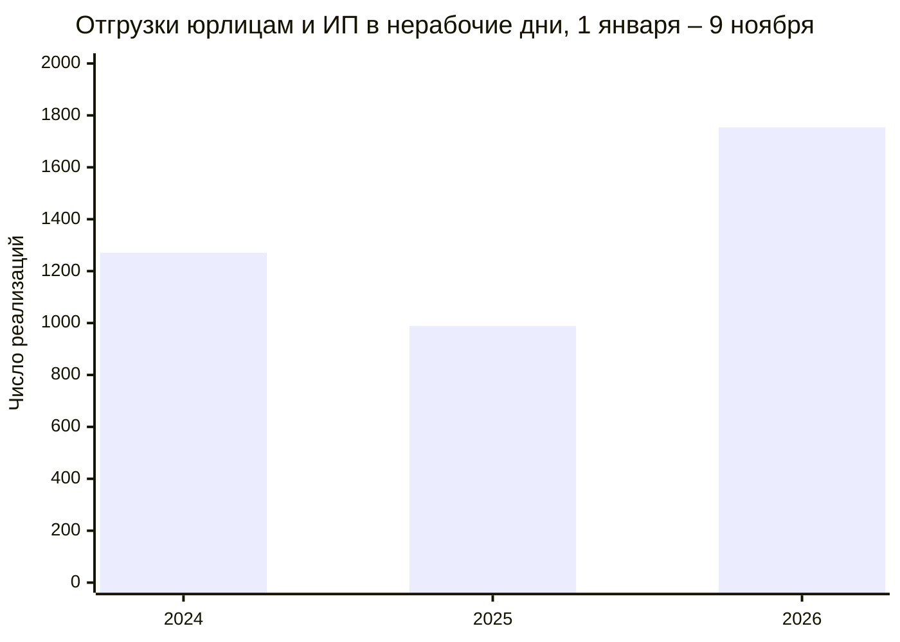

# Отгрузки юрлицам в выходные и праздники

Страница с диаграммами: https://arimberg-svg.github.io/otgruzki-yurikam/

С 1 января по 9 ноября 2026 года юрлицам и ИП оформили **1 754** реализации в субботу, воскресенье или праздник. За те же даты в 2025 году было **989**, в 2024 году **1 271**.

ИП в общем списке. Если в имени клиента стоит «ФЛ», это физлицо, такие отгрузки не входят.

| Магазин | Всего | 2026, по 9 ноября |
| --- | ---: | ---: |
| №17 Луговое | 776 | 376 |
| №5 Бабарынка | 487 | 114 |
| №11 Березняки | 413 | 158 |

Чаще других в такие дни отгружаем НЕОСТРОЙ, ИНЖЕНЕР+, ВЕВАНТА и ГУД ХАУС. Из ИП выше всех Новопашин Иван Владиславович. Подробные таблицы и помесячная линия на странице.

Источник: реализации 1С с 3 января 2024 по 9 ноября 2026. Карточки с пометкой «ФЛ» и передача на комиссию маркетплейсам в счёт не входят.
