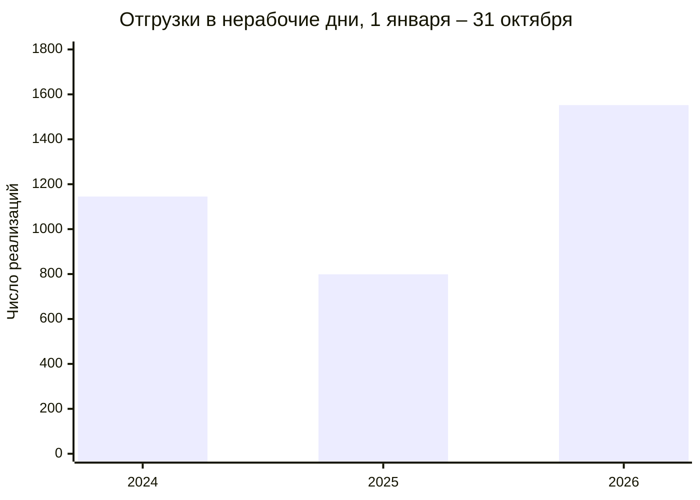

# Отгрузки юрлицам и ИП в выходные и праздники

Страница с диаграммами: https://arimberg-svg.github.io/otgruzki-yurikam/

Период один и тот же: **1 января – 31 октября** 2024, 2025 и 2026 года.

С 1 января по 31 октября 2026 года юрлицам и ИП оформили **1 552** реализации в субботу, воскресенье или праздник. За те же даты в 2025 году было **799**, в 2024 году **1 145**. Это на 94% больше, чем год назад. Доля выросла с 3,5% до 6,9%. Закрытые магазины №4, №8 и №22 в счёт не входят. Карточки физлиц тоже.

ИП в общем списке. Если в имени клиента стоит «ФЛ», это физлицо, такие отгрузки не входят.

На странице есть сводная таблица: магазин и клиент в одной строке, с разбивкой по годам.

В таблице магазинов две колонки из штата. Менеджер по работе с клиентами — из расстановки на 10 ноября 2026 года. СПК в этой выгрузке уже записан как продавец-консультант, поэтому имя СПК сверено с расстановкой на 29 сентября и оставлено, только если человек 10 ноября всё ещё в том же магазине.
