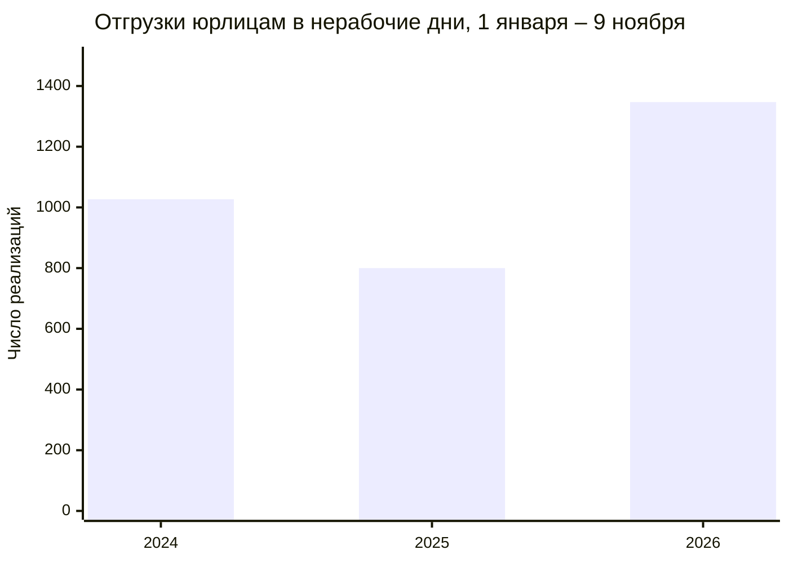

# Отгрузки юрлицам в выходные и праздники

Страница с диаграммами: https://arimberg-svg.github.io/otgruzki-yurikam/

С 1 января по 9 ноября 2026 года юридическим лицам оформили **1 347** реализаций в субботу, воскресенье или праздник. За те же даты в 2025 году было **800**, в 2024 году **1 027**.

Рост сидит в субботе и воскресенье. Праздники в будни почти не изменились.

| Магазин | Всего | 2026, по 9 ноября |
| --- | ---: | ---: |
| №17 Луговое | 660 | 314 |
| №5 Бабарынка | 440 | 103 |
| №7 Ожогина | 242 | 59 |

Чаще других в такие дни отгружаем НЕОСТРОЙ, ИНЖЕНЕР+, ВЕВАНТА и ГУД ХАУС. Подробные таблицы и помесячная линия на странице.

Источник: реализации 1С с 3 января 2024 по 9 ноября 2026. Физлица и передача на комиссию маркетплейсам в счёт не входят.
